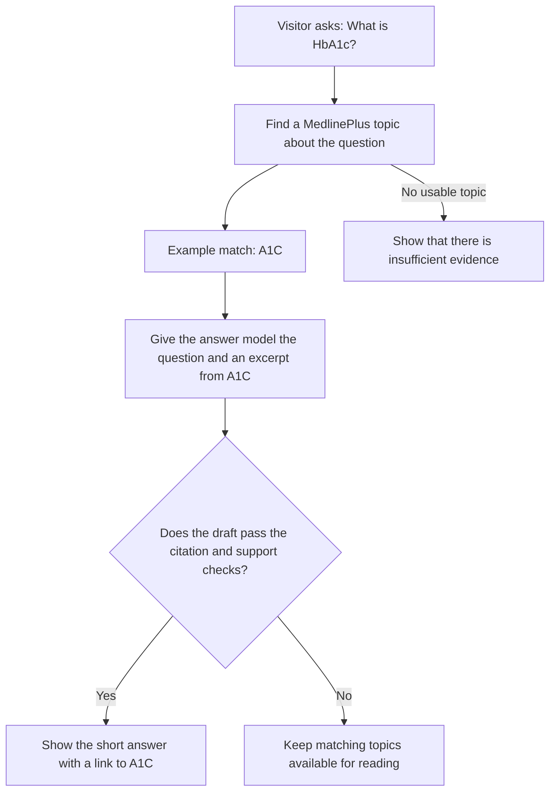
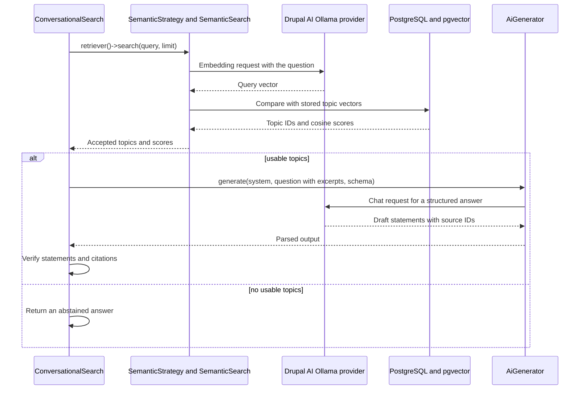

# From a question to a cited answer

[Back to the diagram index](search-uml.md#index)

## What the visitor sees

Think of it as two jobs. The first finds the right reading material. The second uses that material to answer the question. For this example, a visitor can open the A1C citation to read the source directly.

## What the developer sees

The checked-in configuration selects semantic retrieval. The embedding and chat operations use their respective configured models. The diagram follows a deployment with Ollama selected for both.

| Where to pause | What to inspect |
| --- | --- |
| [ConversationalSearch retrieval call](../../web/modules/custom/med_search/src/ConversationalSearch.php#L119) | Step over, then expand `$retrieved['results']`. These are the candidate source topics. |
| [SemanticSearch embedding call](../../web/modules/custom/med_search/src/SemanticSearch.php#L131) | Step over to inspect `$vector`. The SQL compares it with precomputed vectors using pgvector. |
| [ConversationalSearch generation call](../../web/modules/custom/med_search/src/ConversationalSearch.php#L152) | Inspect `$prompt` and `$sources`. The A1C excerpt can appear under source ID `S1`. |
| [AiGenerator provider call](../../web/modules/custom/med_search/src/AiGenerator.php#L77) | Inspect the chat input and configured model before the provider sends the request. |
