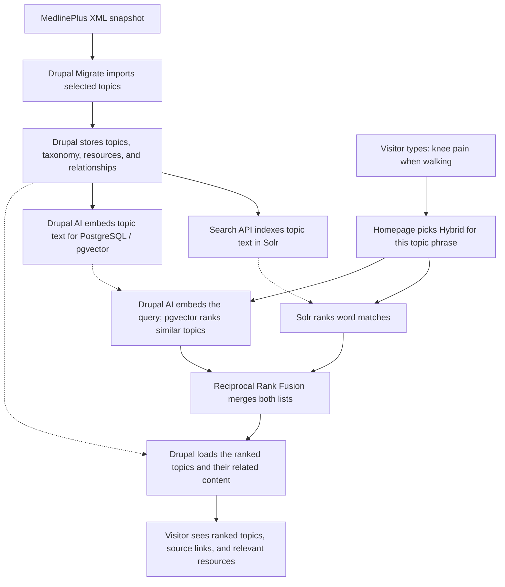
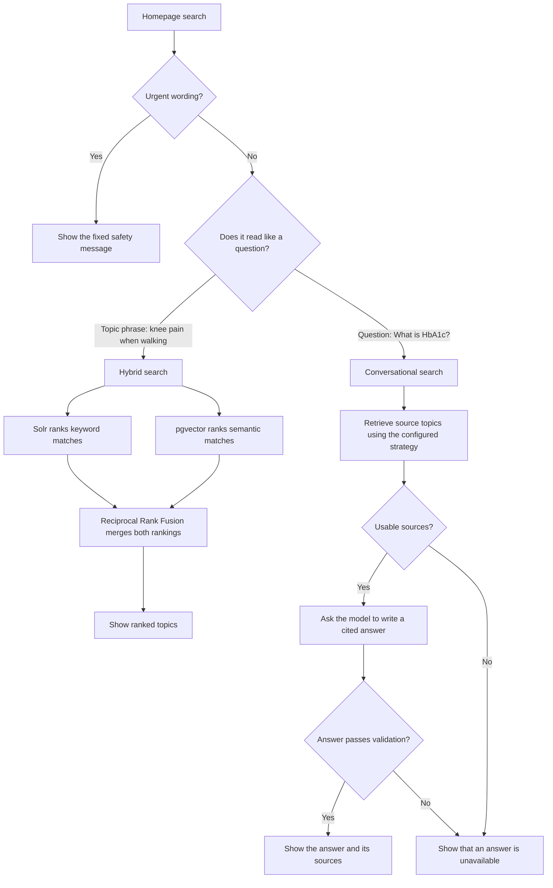
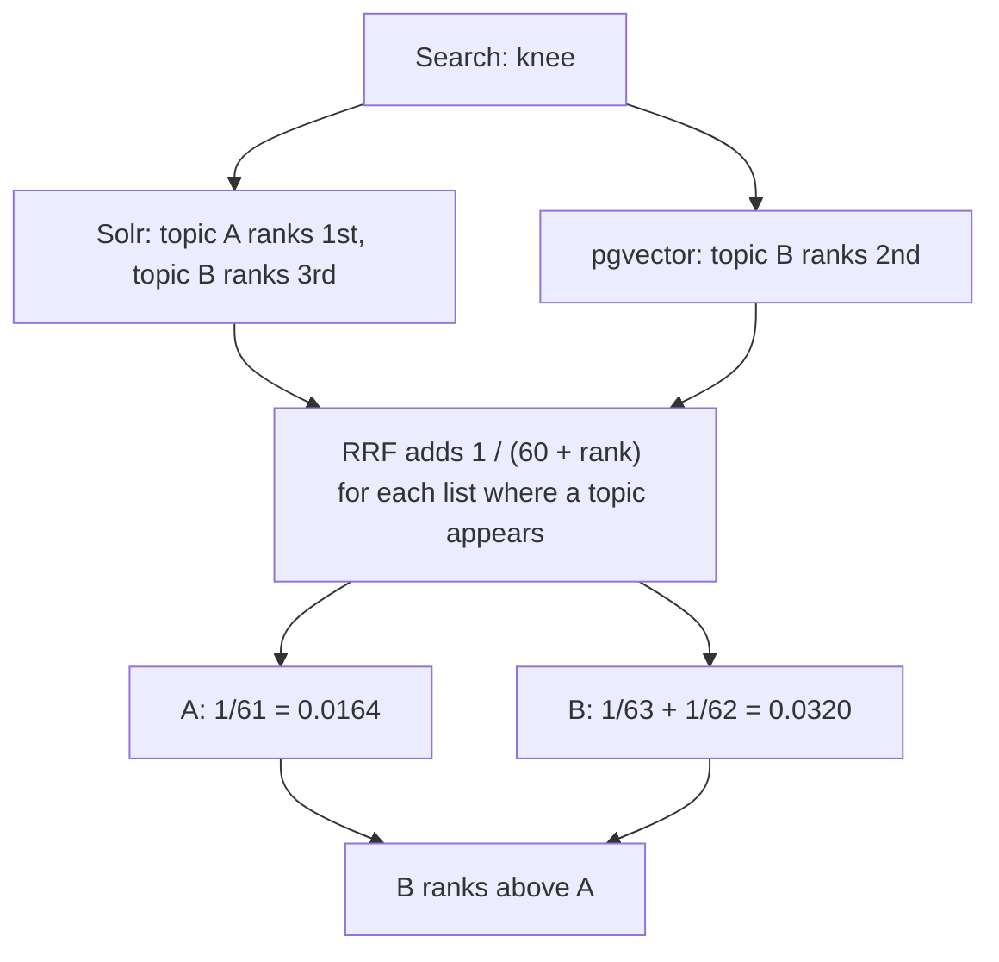
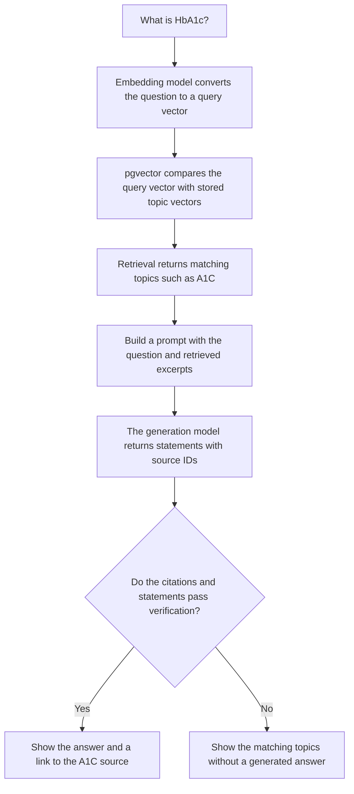
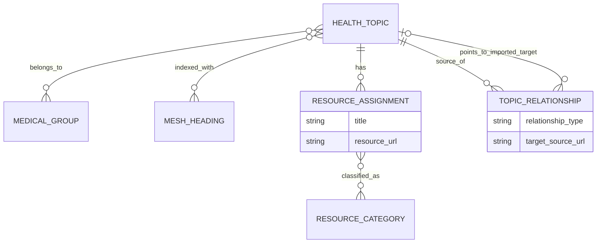
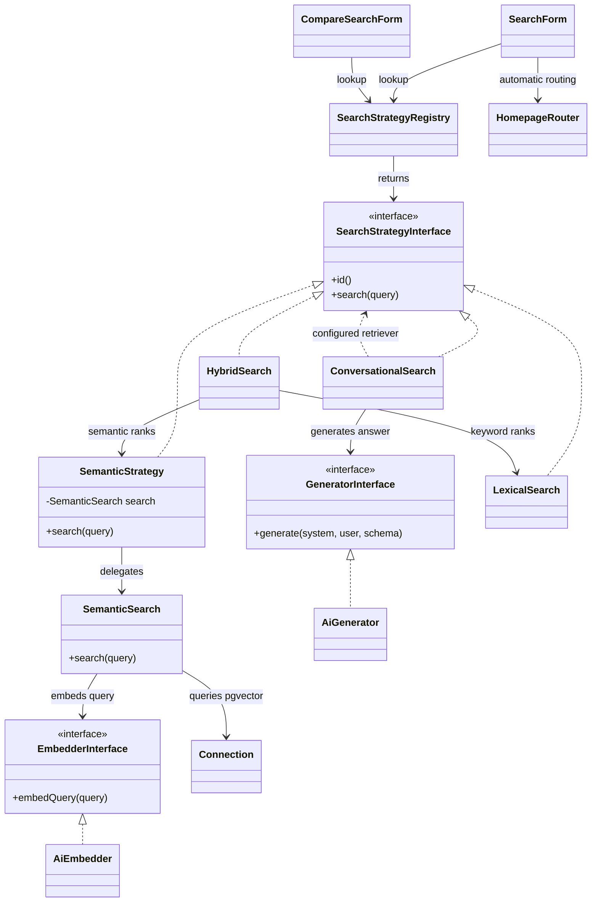
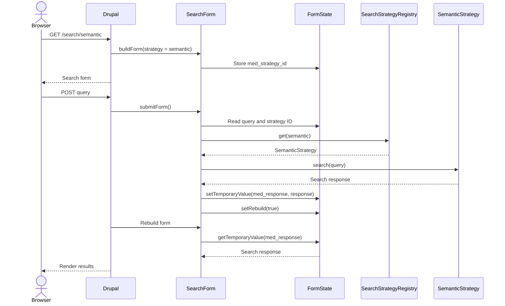
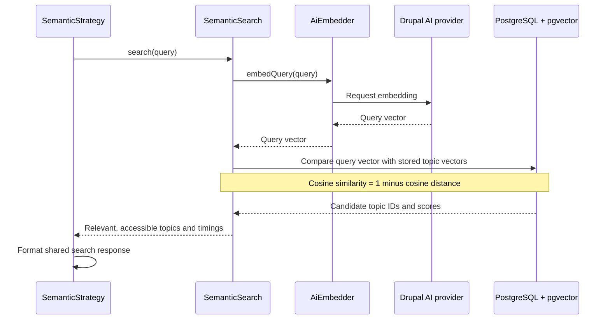

# med_search UML diagrams

GitHub renders these Mermaid diagrams in the Markdown **Preview** tab. The diagrams cover the request path and its main services. They omit Drupal infrastructure and administrative classes.

## Index

1. [End-to-end example](#end-to-end-example)
2. [Homepage routing](#how-the-homepage-chooses-a-search-path)
3. [How Hybrid combines rankings](#how-hybrid-combines-rankings)
4. [Illustrated conversational walkthrough](conversational-walkthrough.md)
5. [How a question becomes a cited answer](#how-a-question-becomes-a-cited-answer)
6. [Drupal content model](#drupal-content-model)
7. [Search classes](#search-classes)
8. [Submit a semantic search](#submit-a-semantic-search)
9. [Retrieve topics with pgvector](#retrieve-topics-with-pgvector)

## End-to-end example



Follow **Knee Injuries and Disorders** as an example of a topic in the index. Its title and text can contribute keyword matches, while its stored vector can contribute a semantic match. Hybrid combines the two rankings, and Drupal uses the original topic and its references to build the result card. The exact position depends on the query and the search configuration.

## How the homepage chooses a search path



The checked-in configuration uses **Semantic** for conversational retrieval. Hybrid merges positions from the two ranked lists using Reciprocal Rank Fusion (RRF). Conversational search uses retrieved excerpts to generate and check a cited answer.

## How Hybrid combines rankings



These positions are illustrative. A topic that ranks well in both lists can outrank the strongest result from just one list.

## How a question becomes a cited answer



The retrieval call in [ConversationalSearch::search()](../../web/modules/custom/med_search/src/ConversationalSearch.php#L119) is:

```php
$retrieved = $this->retriever()->search($query, $limit);
```

With `rag_strategy: semantic`, this reaches [SemanticSearch::search()](../../web/modules/custom/med_search/src/SemanticSearch.php#L131). Its `embedQuery($query)` call turns the question into a vector in the same embedding space as the indexed topics, so pgvector can rank them by cosine similarity. The query vector stays inside the retrieval step. `$retrieved['results']` contains the matching topics and scores. The chat model gets the question and excerpts from those topics in a later call.

In this example, the **A1C** topic can become source **S1** in the prompt. The generation model receives its excerpt. The published answer links back to the source. With the checked-in configuration, medDiscover can include up to three accepted topics.

## Drupal content model



Start with **Knee Injuries and Disorders**. It belongs to the **Injuries and Wounds** medical group and has the **Knee Injuries** MeSH heading. The **Anterior knee pain** resource assignment links to the MedlinePlus article. A separate **Topic Relationship** records the curated link to **Knee Replacement**. A relationship keeps the target URL and can also reference the local Drupal topic when that target was imported.

See the [Drupal content model decision](002-content-model.md) for bundle and field names.

## Search classes



## Submit a semantic search



At [the search call](../../web/modules/custom/med_search/src/Form/SearchForm.php#L475), PHP evaluates `$strategy->search($query)` first. Drupal then stores the returned response in temporary form state for the rebuild.

## Retrieve topics with pgvector


