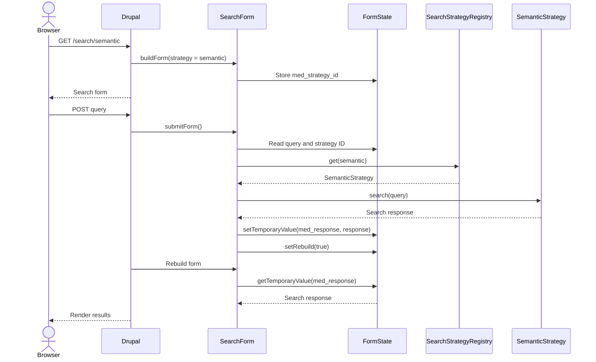
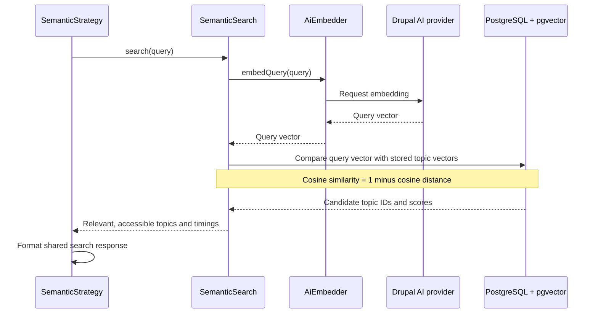

# med_search UML diagrams

GitHub renders these Mermaid diagrams in the Markdown **Preview** tab. The diagrams cover the request path and its main services. They omit Drupal infrastructure and administrative classes.

## Search classes

## Submit a semantic search

At [the search call](../../web/modules/custom/med_search/src/Form/SearchForm.php#L475), PHP evaluates `$strategy->search($query)` first. Drupal then stores the returned response in temporary form state for the rebuild.

## Retrieve topics with pgvector

