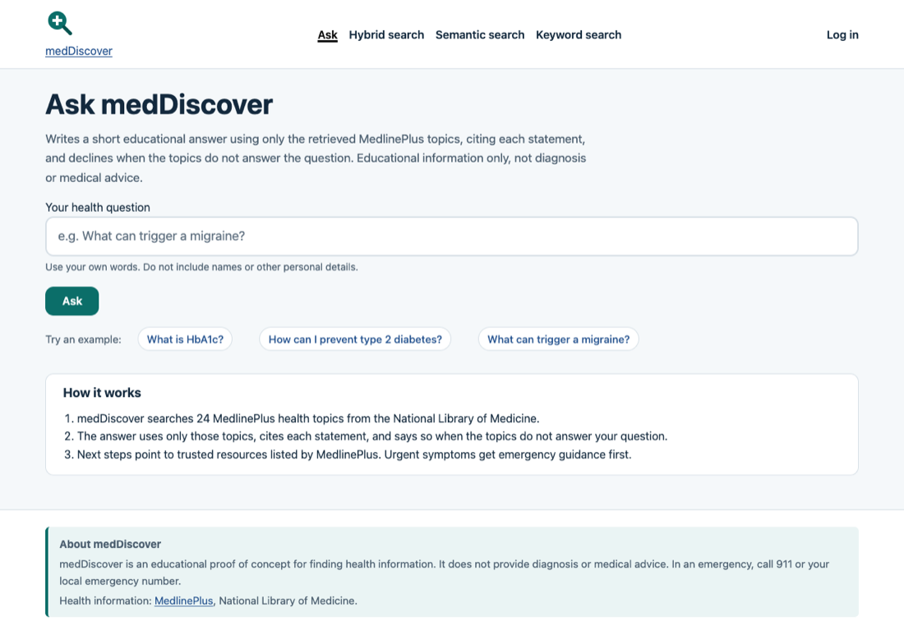
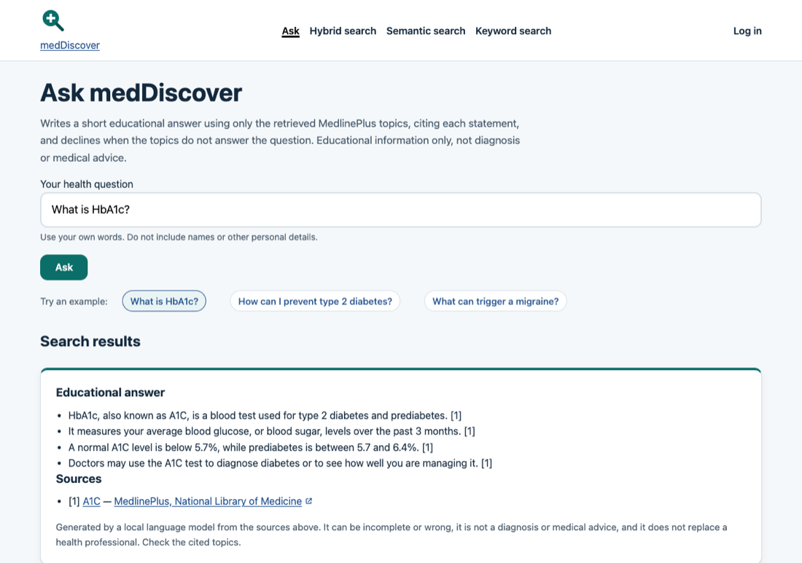
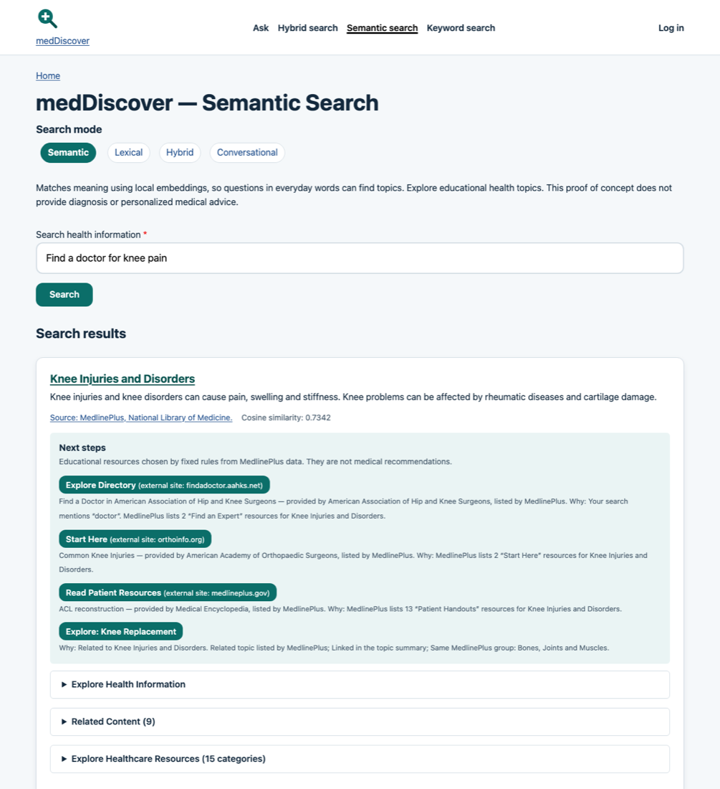
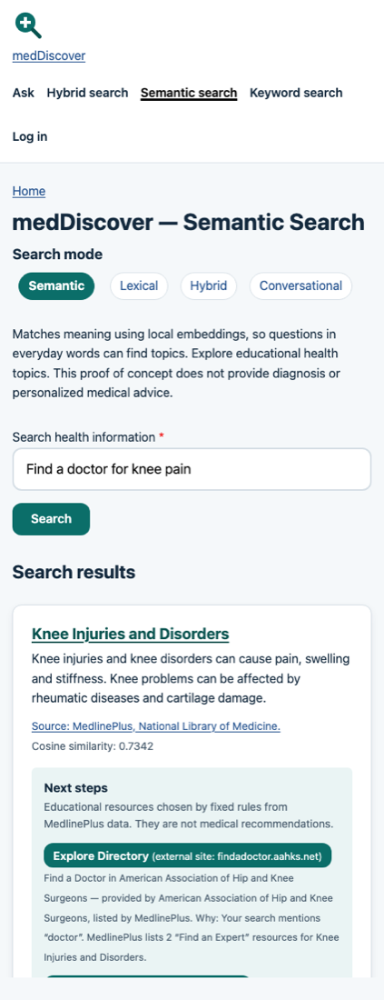

# Phase 09 implementation report

Date: 2026-11-24. Approved scope: UI/UX Enhancement (MVP 6). The owner authorized this phase, asked for core HTMX and a custom theme instead of an Olivero subtheme, and pre-authorized merge once checks pass.

## Issue and review status

- Issue #27: https://github.com/edutrul/meddiscover/issues/27
- The PR link and CI status are recorded in the PR.
- Prerequisite verified: Phase 08 PR #26 merged; issue #25 closed.

## Implementation

Design: [ADR 009](../architecture/009-search-ui.md).

- **`meddiscover` theme** (core Starterkit) is now the default theme, with Claro for admin:
  - Design tokens, a mobile-first header (logo and the main menu *Ask*, *Hybrid search*, *Semantic search*, *Keyword search*) and a footer notice with the educational disclaimer, emergency number and MedlinePlus attribution.
  - Single Directory Components `result-card` and `notice`.
  - The front page is now *Ask* (conversational search).
- **`med_search`:**
  - A `med_search_result` theme hook with a neutral template; the theme maps it to the result card.
  - State classes.
  - Core HTMX progressive enhancement: in-place POST, main content only, a loading indicator with the expected wait, a disabled submit button, an error alert and focus moved to the results.
  - A fix for the missing citation numbers in the Sources list.
- **`med_analytics`:** rates show as accessible `<meter>` bars.
- **`scripts/ui/test_ui.php`:** UI contract test in CI.

## Screenshots (synthetic queries)

| Ask (front page) | Conversational answer |
|---|---|
|  |  |

| Results with next steps (desktop) | Results (500 px) |
|---|---|
|  |  |

## Acceptance criteria

| Criterion | Evidence |
|---|---|
| Responsive interface | Mobile-first layout, wrapping header, pills and cards, long domains wrapping. Checked at 500 px (the headless Chrome minimum) and at 1280 px. |
| Accessible search experience | WCAG AA contrast computed for every pair (minimum 6.1:1); visible focus; focus moved to results after a swap; status and alert live regions; external-site text inside links; reduced motion; a skip link and landmarks. Checklist in ADR 009. |
| Consistent visual components | `result-card` and `notice` SDC, with shared tokens for answers, states, next steps and enrichment. |
| Clear source attribution | Every card links “Source: MedlinePlus, National Library of Medicine”. Answers list numbered sources (fixed in this phase). The footer attributes MedlinePlus on every page. |
| Functional recommendations and CTAs | Next steps render inside each card with reasons and external labels. The activation and analytics contract tests pass, and the analytics hooks still find CTAs (impressions are counted). |
| Search functionality remains unchanged | All eight contract tests pass on a clean install. A plain POST (no JavaScript) and an HTMX POST both return the same results. |
| No performance regressions | Benchmark rerun: end-to-end medians of 10–38 ms for lexical, semantic and hybrid, and about 11.7 s for conversational, the same as Phase 08 within noise, with 0 errors. About 11 KB of theme CSS and JS added, plus core HTMX (51 KB) on search pages only. |

## Validation

- **Clean install from exported configuration, in CI order.** `config:status` shows no differences, and all eight contract tests pass: migration fixture, semantic, enrichment, hybrid, conversation, activation, analytics and UI.
- **Mutation checks.** The UI test fails without HTMX, without the theme's card template, and without source numbers.
- **HTTP.** A plain POST and an HTMX POST (`HX-Request`, `_wrapper_format=drupal_htmx`) both return 200 with results. The report renders meters.
- **Code quality.** PHPCS and the publication check pass.

## Limitations

- **No automated audit.** No automated axe or Lighthouse audit; accessibility was checked with the manual checklist and HTML assertions.
- **Content pages.** Topic and other content pages use Starterkit defaults with the global tokens; the search pages are the designed experience.
- **Conversational wait.** It is announced, not shortened; streaming remains a later option.
- **Approximate narrow check.** The 500 px screenshot approximates mobile because of the headless Chrome minimum.

## Next step

Merge after checks pass and confirm that issue #27 is closed. Recommended next phase: Phase 10 — External Search Providers (Algolia needs an owner-provided account), only after explicit authorization.

## Follow-up after owner review (issue #29)

The owner reviewed the Ask page and pointed out a blank first screen, no placeholder, no examples, and examples that did not appear in the box until the answer came back. An automated **axe-core** audit (WCAG 2.2 AA plus best practice, desktop and 375 px, with headless Chrome through puppeteer-core) reported one moderate issue: `heading-order`.

- **Removed the duplicate mode pills.** The header menu already switches modes. This also fixes `heading-order`.
- **Clearer page titles.** Ask medDiscover, Hybrid search, Semantic search and Keyword search, with a shorter lead.
- **Input guidance.** A per-mode label, an example placeholder (5.1:1 contrast), and a privacy hint, “Do not include names or other personal details”, linked with `aria-describedby`. The button reads **Ask** in conversational mode.
- **One-click example questions.** They are real submit buttons with `formnovalidate`, so they work without JavaScript and with HTMX alike. The box fills immediately on click.
- **Empty state.** It now has a short “How it works” section with an `h2`.
- **Visible validation.** An empty submit is stopped by the native `required` check. Server-side errors render inline through core `inline_form_errors` and set `aria-invalid`, so they stay visible after an HTMX swap. Before, they appeared outside the swapped form and were lost.
- **External links.** Sources, citations, resources, further reading and Next steps are marked with an external-link icon (decorative) and hidden “(external site)” text. Internal topic links have no icon.
- **Selected example.** The clicked example stays visibly selected (`is-selected`, `aria-current="true"`), on the server and immediately in the browser, and clears when the visitor types something else.
- **Scores hidden from the public.** Cosine similarity, Solr scores and RRF ranks are shown only to users with the new *View search ranking details* permission (the uid-1 admin has it), when they turn on Developer mode in the header. The toggle reveals ranking disclosures and per-search timings, and remembers only the on/off preference. To patients, a score reads like medical confidence. A permission is used instead of a `?debug=1` query parameter, which anyone could use.

**Result: axe-core reports 0 violations on the empty and results states, desktop and mobile.** The search URL deliberately does not contain the question; see ADR 009.
